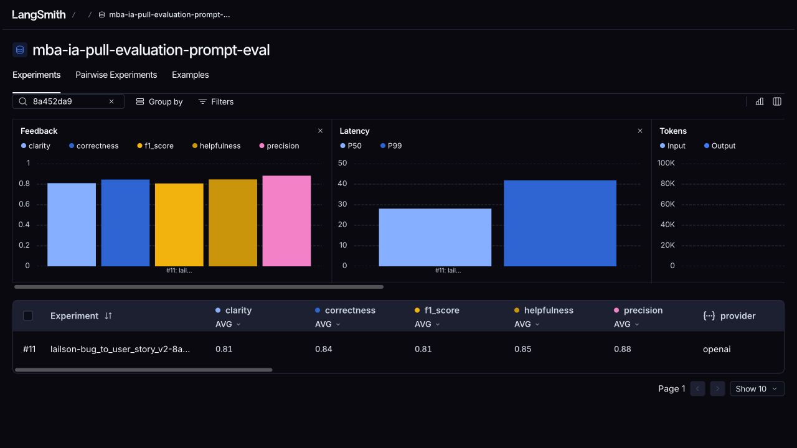
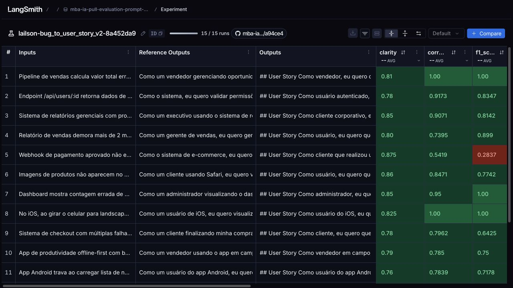

# Otimização de prompts: de relatos de bugs a User Stories

Implementação do desafio de engenharia de prompts com LangChain, OpenAI e LangSmith. O projeto baixa o prompt original, refatora suas instruções, publica a versão otimizada no Hub e avalia a geração de User Stories contra um dataset de 15 relatos de bugs.

**Resultado:** a execução 11 atingiu média ≥ 0,8 em cada uma das cinco métricas. Os seis testes obrigatórios do prompt e os 26 testes da suíte completa passaram.

- [Repositório da entrega — fork público](https://github.com/cobreti999/mba-ia-pull-evaluation-prompt)
- [Repositório base](https://github.com/devfullcycle/mba-ia-pull-evaluation-prompt)
- [Prompt v2 no LangSmith Hub](https://smith.langchain.com/hub/lailson/bug_to_user_story_v2)
- [Dataset e experimentos públicos](https://smith.langchain.com/public/843ce0f5-2616-4911-bfe6-ab30c3f9c85d/d)

## Técnicas Aplicadas (Fase 2)

Foram escolhidas **Role Prompting** e **Few-shot Learning**, registradas no campo `techniques_applied` de [prompts/bug_to_user_story_v2.yml](prompts/bug_to_user_story_v2.yml).

### Role Prompting

**Justificativa:** a tarefa exige decisões de produto: identificar quem é afetado, expressar o benefício esperado e definir critérios verificáveis por desenvolvimento e QA. A persona de Product Manager orienta essas decisões e o nível de detalhe da especificação.

**Aplicação prática:** o system prompt atribui explicitamente a função:

> Você é um Product Manager experiente em transformar relatos de bugs em User Stories claras e acionáveis para desenvolvimento e QA.

As instruções exigem ator, ação e benefício, preservação das evidências e separação entre fatos, hipóteses e sugestões técnicas. Em integrações automáticas, por exemplo, “sistema” pode ser o ator. O prompt também exige preservar os nomes dos estados do domínio, como “pendente” e “aprovado”.

### Few-shot Learning

**Justificativa:** exemplos demonstram o formato e a profundidade desejados de maneira mais concreta que uma lista de instruções. Também mostram como tratar relatos simples, falhas relacionadas e informações incompletas.

**Aplicação prática:** o system prompt contém três pares completos de entrada e saída, autorais e diferentes dos casos do dataset:

| Exemplo | Entrada | Comportamento demonstrado |
| --- | --- | --- |
| Favoritos | Um artigo removido continua na lista até recarregar a página. | User Story objetiva e critérios para remoção imediata e persistência. |
| Reserva de salas | Reservas simultâneas conflitantes, HTTP 503 e perda de seleção após falha. | Cenários separados de concorrência, falha, nova tentativa e confirmação, com contexto técnico. |
| Histórico de aulas | “Erro ao carregar”, sem informação de quando começou. | Produzir critérios sustentados pelo relato e perguntas específicas para as lacunas. |

Trecho da saída do exemplo de favoritos:

```markdown
## User Story
Como um leitor, eu quero remover um artigo dos favoritos e ver a lista atualizada,
para que ela reflita os artigos que desejo guardar.

## Critérios de Aceitação
- Dado que um artigo está na minha lista de favoritos
- Quando desmarco esse artigo dos favoritos e a remoção é concluída
- Então ele deixa de aparecer na lista sem recarregar a página
```

### Refinamentos das instruções

Além das duas técnicas, a v2 define resposta em português brasileiro e Markdown, critérios Dado/Quando/Então, profundidade proporcional ao relato e tratamento de entradas vazias ou contraditórias. Os ajustes finais reforçam:

- Transições de estado com a terminologia original do relato.
- Restrição de requisitos adicionais, como idempotência e retries sem suporte no relato.
- Critérios gerais de contagem e filtro por status ativo.
- Preservação de plataforma, volume, duração do travamento e thread no contexto técnico.
- Critérios separados para carregamento fora da thread principal, ausência de congelamento/ANR e carregamento incremental.

## Resultados Finais

### Dataset e experimento aprovado

O [dataset público `mba-ia-pull-evaluation-prompt-eval`](https://smith.langchain.com/public/843ce0f5-2616-4911-bfe6-ab30c3f9c85d/d) expõe os **15 exemplos** e os experimentos realizados. A aba **Examples** permite inspecionar os relatos e as referências; a aba **Experiments** permite comparar as avaliações.

A execução final foi **`lailson-bug_to_user_story_v2-8a452da9`**:

- [Abrir execução 11](https://smith.langchain.com/public/843ce0f5-2616-4911-bfe6-ab30c3f9c85d/d/compare?selectedSessions=61cd278e-2c90-4d7e-bbc0-69a8e319379d)
- Commit do prompt: `44b0d9e43de7a18eb1acd10283bb1801749ba701bd736dd91388909c0db41577`.
- Geração e juízes: **OpenAI `gpt-5-nano`**.
- Parâmetros padrão do provedor, concorrência 1 e uma repetição por exemplo.
- **15 respostas e 75 notas**, preservadas em [11-results.json](evidence/iterations/11-results.json).
- [Configuração conferida nos traces](evidence/iterations/11-config.json).

| Métrica | Execução 10 | Execução 11 | Meta | Situação final |
| --- | ---: | ---: | ---: | --- |
| Helpfulness | 0,8344 | **0,8463** | ≥ 0,8 | Aprovada |
| Correctness | 0,8325 | **0,8448** | ≥ 0,8 | Aprovada |
| F1-Score | 0,7702 | **0,8070** | ≥ 0,8 | Aprovada |
| Clarity | 0,7742 | **0,8100** | ≥ 0,8 | Aprovada |
| Precision | 0,8947 | **0,8827** | ≥ 0,8 | Aprovada |
| Média geral | 0,8212 | **0,8382** | ≥ 0,8 | Aprovada |

A aprovação exige média ≥ 0,8 nos 15 exemplos **em cada métrica**, além da média geral. Isso não significa que todas as notas individuais sejam ≥ 0,8. F1, Clarity e Precision são avaliados por juízes LLM; Helpfulness é a média entre Clarity e Precision, e Correctness é a média entre F1 e Precision, conforme o código original.

### Screenshots das avaliações

A tabela do dataset público mostra as cinco médias da execução 11 acima de 0,8. A interface arredonda os valores para duas casas; o relatório JSON preserva os valores exportados.



A captura abaixo mostra as respostas e as notas por exemplo da mesma execução:



### Tracing detalhado de três exemplos

Os links abrem o trace de cada resposta dentro do experimento público. Expanda o painel do trace para consultar a chamada ao modelo, a entrada, a saída e os feedbacks.

| Exemplo | F1 na execução 10 | F1 na execução 11 | Trace público |
| --- | ---: | ---: | --- |
| Dashboard: contagem de usuários ativos | 0,4800 | 1,0000 | [Abrir trace do Dashboard](https://smith.langchain.com/public/843ce0f5-2616-4911-bfe6-ab30c3f9c85d/d/compare?selectedSessions=61cd278e-2c90-4d7e-bbc0-69a8e319379d&trace=01a14ff9-bb38-7102-bbe7-8fa62e1de0b5&peeked_trace_id=01a14ff9-bb38-7102-bbe7-8fa62e1de0b5) |
| Android: travamento ao carregar notificações | 0,6346 | 0,7178 | [Abrir trace do Android](https://smith.langchain.com/public/843ce0f5-2616-4911-bfe6-ab30c3f9c85d/d/compare?selectedSessions=61cd278e-2c90-4d7e-bbc0-69a8e319379d&trace=01a14ff7-1dcd-70a2-a382-943f1e51f17c&peeked_trace_id=01a14ff7-1dcd-70a2-a382-943f1e51f17c) |
| Webhook: confirmação de pagamento | 0,8147 | 0,2837 | [Abrir trace do webhook](https://smith.langchain.com/public/843ce0f5-2616-4911-bfe6-ab30c3f9c85d/d/compare?selectedSessions=61cd278e-2c90-4d7e-bbc0-69a8e319379d&trace=01a14ff8-dd9f-7660-94f8-1dbc056c4235&peeked_trace_id=01a14ff8-dd9f-7660-94f8-1dbc056c4235) |

O [guia de revisão manual](evidence/REVIEW-11.md) reúne os três casos completos, com as respostas antes/depois, as referências e as justificativas dos juízes. A [comparação dos 15 exemplos](evidence/iterations/11-comparison.json) preserva os demais casos.

### Comparação entre o prompt original (v1) e o otimizado (v2)

A [v1](prompts/bug_to_user_story_v1.yml) foi obtida de `leonanluppi/bug_to_user_story_v1`, commit `2950c33dbd7ffaed2e440b50adfd7769d183f90faf0bae5aa4864354f88e4073`. Ela define um assistente genérico e pede a conversão do relato em User Story. A [v2](prompts/bug_to_user_story_v2.yml) acrescenta orientação de produto, estrutura verificável e exemplos práticos.

| Aspecto | v1 | v2 | Motivo da mudança |
| --- | --- | --- | --- |
| Persona | Assistente genérico. | Product Manager com foco em desenvolvimento e QA. | Orientar ator, benefício e critérios verificáveis. |
| Formato | Solicitação genérica de User Story. | Markdown, User Story e critérios Dado/Quando/Então. | Tornar a entrega previsível e verificável. |
| Demonstrações | Sem exemplos. | Três pares autorais de entrada e saída. | Demonstrar formato, profundidade e tratamento de lacunas. |
| Evidências | Sem regras específicas de preservação. | Preserva contexto técnico, números, estados e condições do relato. | Reduzir perda de informações relevantes. |
| Requisitos adicionais | Sem limites explícitos. | Distingue fatos, hipóteses e sugestões; restringe acréscimos sem suporte. | Reduzir suposições e requisitos inventados. |
| Complexidade | Uma instrução para qualquer relato. | Ajusta profundidade e separa falhas relacionadas ou independentes. | Cobrir problemas complexos sem alongar desnecessariamente os simples. |
| Entradas problemáticas | Sem tratamento explícito. | Regras para relato vazio, parcial, contraditório e instruções embutidas. | Evitar especificações sem fundamento no relato. |

A comparação v1 × v2 é **qualitativa**: não foi executada uma avaliação quantitativa da v1. As notas documentadas pertencem às iterações da v2, portanto não demonstram um ganho numérico sobre a v1.

### Histórico e limites da avaliação

Foram concluídos **11 experimentos**, com snapshots e resultados em [evidence/iterations/](evidence/iterations/README.md). A execução 09 repetiu a configuração da primeira; a 10 ajustou estados e requisitos adicionais; a 11 acrescentou as orientações para contagem e listas com travamento. Os parâmetros finais de geração e avaliação foram conferidos em relação à execução anterior.

As notas variaram entre execuções. O webhook, por exemplo, regrediu na execução 11, e o juiz do Dashboard atribuiu F1 máximo apesar de a resposta não explicitar todo o filtro solicitado. Esses pontos estão registrados no guia de revisão, sem edição manual das notas. Os ajustes usaram o próprio dataset de avaliação; não houve conjunto independente de teste nem demonstração de estabilidade estatística. Os testes locais verificam o prompt, mas não garantem a obediência do modelo às instruções.

## Como Executar

### Pré-requisitos e dependências

- Git e Python com `venv` e `pip`. Ambiente validado: **Python 3.14.7**.
- Conta no LangSmith, chave de API e um handle público no Prompt Hub.
- Chave OpenAI com acesso a `gpt-5-nano`, usado tanto para gerar quanto para avaliar.
- Conexão de rede para pull, publicação e avaliação. Os testes locais não exigem chaves nem rede.

As versões das dependências estão fixadas em [requirements.txt](requirements.txt): LangChain Core, LangSmith, os conectores OpenAI e Google Gemini, python-dotenv, PyYAML, Pydantic e pytest. A entrega utiliza o provider OpenAI.

### 1. Obter o repositório e instalar dependências

O repositório da entrega já é um fork; não é necessário criar outro para executar.

```bash
git clone https://github.com/cobreti999/mba-ia-pull-evaluation-prompt.git
cd mba-ia-pull-evaluation-prompt
python3 -m venv venv
source venv/bin/activate
python -m pip install -r requirements.txt
```

No Windows, ative o ambiente com `venv\Scripts\Activate.ps1` no PowerShell ou `venv\Scripts\activate.bat` no Prompt de Comando. Execute os comandos seguintes a partir da raiz do repositório, com o ambiente ativado.

### 2. Configurar o ambiente

Na primeira configuração, copie o exemplo para `.env`. Se o arquivo já existir, edite-o.

```bash
cp .env.example .env
```

Preencha os valores no arquivo local:

```dotenv
LANGSMITH_TRACING=true
LANGSMITH_ENDPOINT=https://api.smith.langchain.com
LANGSMITH_API_KEY=preencha_sua_chave_langsmith
LANGSMITH_PROJECT=mba-ia-pull-evaluation-prompt
USERNAME_LANGSMITH_HUB=lailson
LLM_PROVIDER=openai
LLM_MODEL=gpt-5-nano
EVAL_MODEL=gpt-5-nano
OPENAI_API_KEY=preencha_sua_chave_openai
```

As chaves também podem estar nas variáveis de ambiente do processo. O `.env` é ignorado pelo Git. `USERNAME_LANGSMITH_HUB` recebe somente o handle, sem `/nome-do-prompt`; para publicar em outra conta, substitua `lailson` pelo seu handle. O prompt publicado é `{USERNAME_LANGSMITH_HUB}/bug_to_user_story_v2`. O dataset recebe o nome `{LANGSMITH_PROJECT}-eval`.

### Fase 1 — Pull do prompt original

```bash
python src/pull_prompts.py
```

Baixa `leonanluppi/bug_to_user_story_v1` e salva mensagens, origem e commit em `prompts/bug_to_user_story_v1.yml`.

### Fase 2 — Refatorar e validar a v2

O arquivo `prompts/bug_to_user_story_v2.yml` já está preenchido e funcional. Para uma nova versão, edite `system_prompt`, `user_prompt` e os metadados, mantendo a variável `{bug_report}` e as técnicas declaradas. Valide o conteúdo local:

```bash
python -m pytest tests/test_prompts.py -v
```

### Fase 3 — Publicar no LangSmith Hub

```bash
python src/push_prompts.py
```

O script valida o YAML, publica o prompt público no handle configurado e relê o commit para conferir mensagens, visibilidade e metadados. Guarde o hash impresso para associar o conteúdo publicado ao experimento.

### Fase 4 — Avaliar e iterar

```bash
python src/evaluate.py
```

O avaliador cria ou reutiliza o dataset com os 15 exemplos, busca a v2 **publicada no Hub**, gera respostas e registra as cinco notas por exemplo. Cada execução cria um experimento. Após editar o YAML, execute novamente o push antes da avaliação.

O processo retorna código 0 quando todas as médias atingem 0,8 e código 1 quando a meta não é atingida ou ocorre falha. A avaliação faz chamadas pagas à API e pode levar vários minutos. Na configuração final, geração e juízes usam `gpt-5-nano` sem opções explícitas de raciocínio, verbosidade ou modo JSON. O SDK instalado omite `temperature=0` para esse modelo.

Para exportar uma avaliação já concluída, sem novas chamadas aos modelos:

```bash
python src/export_evaluation.py NOME_DO_EXPERIMENTO \
  --prompt-commit HASH_IMPRESSO_NO_PUSH \
  --output results/relatorio.json
```

O exportador exige uma resposta concluída e cinco notas válidas por exemplo. Se os feedbacks ainda estiverem em propagação, aguarde e repita somente a exportação. Não é necessário executar o avaliador novamente.

### Compartilhar as evidências no LangSmith

O link impresso pelo avaliador usa o workspace e pode exigir autenticação. Para esta entrega, utilize o endereço público já criado:

[Dataset público e experimentos da entrega](https://smith.langchain.com/public/843ce0f5-2616-4911-bfe6-ab30c3f9c85d/d).

Para compartilhar um dataset próprio pela primeira vez, execute **uma única vez**:

```bash
python - <<'PY'
import os
from dotenv import load_dotenv
from langsmith import Client

load_dotenv('.env')
dataset_name = f"{os.environ['LANGSMITH_PROJECT']}-eval"
print(Client().share_dataset(dataset_name=dataset_name)['url'])
PY
```

Guarde o endereço retornado. Compartilhar novamente muda o link; por isso, **não reexecute esse comando para o dataset desta entrega**. O compartilhamento do dataset expõe junto os experimentos vinculados a ele.

### Fase 5 — Executar os testes de validação

```bash
python -m pytest tests/test_prompts.py -v
python -m pytest tests -q
```

Os seis testes obrigatórios verificam system prompt não vazio, persona, instrução de formato, exemplos completos de entrada/saída, ausência de TODOs e duas técnicas distintas. Os testes auxiliares cobrem pull, publicação e integridade das evidências.

**Resultado registrado: 6 testes obrigatórios aprovados e 26 testes aprovados no total.** Consulte o [guia dos testes](evidence/REVIEW-05-tests.md) e a [saída da suíte completa](evidence/requirement-5-tests.txt).

## Estrutura da entrega

```text
prompts/
  bug_to_user_story_v1.yml    # Prompt original e commit de origem
  bug_to_user_story_v2.yml    # Prompt otimizado completo
src/
  pull_prompts.py            # Download e preservação da v1
  push_prompts.py            # Validação, publicação e conferência da v2
  evaluate.py                # Avaliador original do desafio
  metrics.py                 # Métricas originais
  utils.py                   # Utilitários originais
  export_evaluation.py       # Exportação de resultados, sem reavaliar
  run_iteration.py           # Executor auxiliar de iterações anteriores
datasets/
  bug_to_user_story.jsonl    # 15 exemplos originais
tests/
  test_prompts.py            # Seis testes exigidos
  test_pull_prompts.py
  test_push_prompts.py
  test_iteration_evidence.py
evidence/
  iterations/               # Snapshots, resultados e comparações
  REVIEW-11.md              # Revisão manual da avaliação aprovada
  REVIEW-05-tests.md        # Revisão do requisito 5
  evaluation-11-means.png   # Screenshot das médias aprovadas
  evaluation-11.png         # Screenshot das notas por exemplo
```

Os arquivos fornecidos `src/evaluate.py`, `src/metrics.py`, `src/utils.py` e `datasets/bug_to_user_story.jsonl` foram preservados. O diretório `results/` contém saídas locais e é ignorado pelo Git; as evidências da entrega ficam em `evidence/`.
