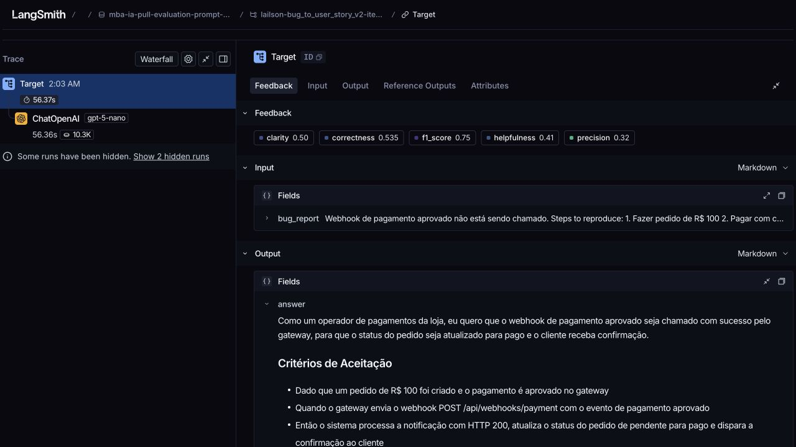
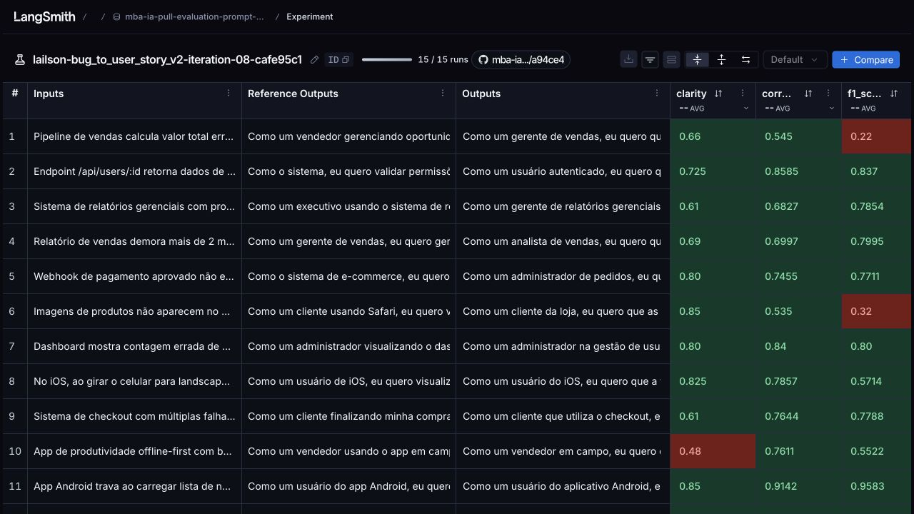

# Revisão manual — Requisito 4

Meta de 0.8 nas cinco médias não atingida. Novas tentativas interrompidas conforme solicitado para revisão manual.

[Dataset e experimentos públicos](https://smith.langchain.com/public/843ce0f5-2616-4911-bfe6-ab30c3f9c85d/d).

## Resultados medidos

| Iteração | Helpfulness | Correctness | F1 | Clarity | Precision | Média | Aprovado |
| --- | --- | --- | --- | --- | --- | --- | --- |
| [01](iterations/01-results.json) | 0.8322 | 0.8351 | 0.7697 | 0.7640 | 0.9005 | 0.8203 | Não |
| [02](iterations/02-results.json) | 0.8133 | 0.7612 | 0.6718 | 0.7760 | 0.8507 | 0.7746 | Não |
| [03](iterations/03-results.json) | 0.8184 | 0.7762 | 0.6790 | 0.7635 | 0.8733 | 0.7821 | Não |
| [04](iterations/04-results.json) | 0.8378 | 0.7887 | 0.6940 | 0.7922 | 0.8833 | 0.7992 | Não |
| [05](iterations/05-results.json) | 0.7659 | 0.7771 | 0.7395 | 0.7172 | 0.8147 | 0.7629 | Não |
| [06](iterations/06-results.json) | 0.7703 | 0.8064 | 0.7914 | 0.7193 | 0.8213 | 0.7817 | Não |
| [07](iterations/07-results.json) | 0.7982 | 0.8114 | 0.7775 | 0.7510 | 0.8453 | 0.7967 | Não |
| [08](iterations/08-results.json) | 0.7636 | 0.7176 | 0.6384 | 0.7303 | 0.7969 | 0.7294 | Não |

Cada experimento contém 15 exemplos e 75 notas. A aprovação exige pelo menos 0.8 em cada média; não basta a média geral. O relatório também registra se todas as notas individuais passaram.

## Configuração da última execução

- Experimento: `lailson-bug_to_user_story_v2-iteration-08-cafe95c1`.
- Commit do prompt: `51e3e9ce19d961469345e5847a621bb7129337cadb5ca9b33a408cf50dc2cac3`.
- Geração e avaliação: `gpt-5-nano`.
- Raciocínio: `high` nos dois papéis; juiz em modo JSON e geração com verbosidade `low`.
- O dataset, os textos dos avaliadores e as fórmulas originais não foram alterados.

As configurações do juiz mudaram nas últimas execuções; portanto, diferenças das notas não podem ser atribuídas somente ao prompt. O mesmo conjunto de 15 exemplos orientou os ajustes e a avaliação: não é uma validação independente de generalização.

## Onde revisar

- [Prompt da última execução](iterations/08-prompt.yml).
- [Relatório completo da última execução](iterations/08-results.json).
- [Snapshots e histórico](iterations/README.md).
- [Executor das iterações](../src/run_iteration.py).
- [Exportação e validação das evidências](../src/export_evaluation.py).

## Casos para inspeção

Os três casos abaixo foram selecionados pelas menores notas individuais da última execução. As justificativas são do juiz e podem conter imprecisões; compare-as com a saída e a referência antes de concluir se a falha é do prompt ou da avaliação.

### 1. Pipeline de vendas calcula valor total errado quando há desconto.

[Trace público deste exemplo](https://smith.langchain.com/public/843ce0f5-2616-4911-bfe6-ab30c3f9c85d/d/compare?selectedSessions=e2db60f3-3474-4e79-8d77-166b71b2d4fd&trace=01a14d6e-f5c0-7163-ad51-e836ced046e8&peeked_trace_id=01a14d6e-f5c0-7163-ad51-e836ced046e8)

| Helpfulness | Correctness | F1 | Clarity | Precision |
| --- | --- | --- | --- | --- |
| 0.7650 | 0.5450 | 0.2200 | 0.6600 | 0.8700 |

**Relato**

````text
Pipeline de vendas calcula valor total errado quando há desconto.

Cenário:
- Produto A: R$ 1.000
- Produto B: R$ 500
- Desconto: 10%
- Valor esperado: R$ 1.350
- Valor mostrado: R$ 1.400

O sistema aplica desconto só no primeiro produto.
````

**Resposta gerada**

````markdown
Como um gerente de vendas, eu quero que o pipeline calcule corretamente o total com desconto aplicado ao total, para que o valor cobrado ao cliente reflita corretamente o desconto de 10%.

## Critérios de Aceitação — comportamento esperado após a correção
- Dado que o carrinho contém Produto A: R$ 1.000 e Produto B: R$ 500, com desconto de 10% aplicado ao total
- Quando o cálculo de total é executado
- Então o sistema deverá exibir o total com desconto de R$ 1.350
- E deverá o desconto de R$ 150 aparecer como linha separada de desconto no resumo, mantendo os itens com preço original
- E deverá o total com desconto ser utilizado pelo faturamento e pela tela de confirmação, sem variações entre recálculos ou alterações nos itens

## Contexto Técnico
- Evidência: o cálculo atual aplica 10% apenas ao primeiro item, gerando 1.400 (1.000 com desconto + 500).
- Correção técnica correspondente: calcular o desconto com base no subtotal da venda (1.500) e aplicar 10% ao total, resultando 1.350; exibir o desconto de 150 como linha separada no resumo.
- Proposta a validar: aplicar o desconto no total da venda (ou manter itemização com linha de desconto), assegurando que o cálculo seja idempotente e consistente com o faturamento; se a regra exigir desconto por item, esclarecer nos critérios de aceitação e impactar a UI/relatórios.
- Impacto: divergência entre o valor exibido no pipeline e o valor cobrado, severidade média.
````

**Referência do dataset**

````text
Como um vendedor gerenciando oportunidades no pipeline, eu quero que o valor total seja calculado corretamente quando aplico descontos, para que eu possa apresentar propostas precisas aos clientes.

Critérios de Aceitação:
- Dado que tenho uma oportunidade com múltiplos produtos
- Quando aplico um desconto percentual
- Então o desconto deve ser aplicado no valor total de todos os produtos
- E o valor final deve ser: (soma dos produtos) × (1 - desconto%)
- E o detalhamento deve mostrar: subtotal, desconto e total

Exemplo de Cálculo:
- Produto A: R$ 1.000
- Produto B: R$ 500
- Subtotal: R$ 1.500
- Desconto 10%: -R$ 150
- Total: R$ 1.350

Contexto Técnico:
- Bug atual: desconto sendo aplicado apenas no primeiro produto
- Resultado incorreto: R$ 1.400 (deveria ser R$ 1.350)
````

**Justificativas originais do juiz**

- **f1_score:** A resposta correta apenas afirma que o desconto deve ser aplicado ao total e menciona 10%, o que está alinhado com a ideia central. No entanto, não apresenta o cálculo (subtotal, desconto, total), nem o exemplo com 1.500, 150 e 1.350, nem detalhes sobre o bug, propondo apenas um objetivo genérico. Assim, contém pouca informação relevante do Ground Truth e omite várias informações-chave.
- **clarity:** Organização: boa estrutura com Given-When-Then e exemplos, mas há seções extras (Contexto Técnico, Proposta a validar, Impacto) que desviam o foco da avaliação de clareza. Linguagem: clara e direta, com vocabulário comum; evita jargões complexos. Ausência de ambiguidade: maior parte é explícita, porém a frase 'ou manter itemização com linha de desconto' pode gerar dúvida sobre a necessidade de linha de desconto. Concisão: o texto é relativamente longo e repetitivo, com redundâncias ('desconto aplicado ao total'), poderia ser mais direto. Nota global: 0.66.
- **precision:** Avaliação: não há alucinações (a resposta apenas repete o objetivo). O foco na pergunta é parcial: não detalha aplicar desconto ao total versus por item nem descreve a linha de desconto, subtotal/total, ou a relação com faturamento, elementos presentes na ground truth (ex.: Subtotal 1.500; Desconto 150; Total 1.350). Em termos factuais, a resposta é correta, mas pouco detalhada. Atribuo Ausência de alucinações = 1.0; Foco na pergunta = 0.6; Correção factual = 1.0. Média ≈ (1.0+0.6+1.0)/3 = 0.87.

### 2. Campo de email aceita texto sem @, permitindo cadastros inválidos.

[Trace público deste exemplo](https://smith.langchain.com/public/843ce0f5-2616-4911-bfe6-ab30c3f9c85d/d/compare?selectedSessions=e2db60f3-3474-4e79-8d77-166b71b2d4fd&trace=01a14d70-7869-7d10-b917-1212d242fb5f&peeked_trace_id=01a14d70-7869-7d10-b917-1212d242fb5f)

| Helpfulness | Correctness | F1 | Clarity | Precision |
| --- | --- | --- | --- | --- |
| 0.7850 | 0.5303 | 0.2906 | 0.8000 | 0.7700 |

**Relato**

````text
Campo de email aceita texto sem @, permitindo cadastros inválidos.
````

**Resposta gerada**

````markdown
Como um usuário, eu quero que o campo de email seja validado para exigir formato válido, para que cadastros inválidos não sejam criados.

## Critérios de Aceitação — comportamento esperado após a correção
- Dado que estou na tela de cadastro com email sem @
- Quando tento submeter o cadastro
- Então o sistema deverá bloquear a submissão e exibir uma mensagem de erro informando que o formato de email é inválido
- E deverá validar o formato do email no backend, retornando HTTP 422 com mensagem de erro se o email for inválido

## Contexto Técnico
- Evidência: Campo de email aceita texto sem '@', permitindo cadastros inválidos. Proposta a validar: adicionar validação de formato de email no frontend e no backend (regex simples: ^[^@\s]+@[^@\s]+\.[^@\s]+$); retornar HTTP 422 com mensagem de erro.
````

**Referência do dataset**

````text
Como um usuário criando uma conta, eu quero que o sistema valide meu email corretamente, para que eu não insira um endereço inválido por engano.

Critérios de Aceitação:
- Dado que estou no formulário de cadastro
- Quando digito um email sem o caractere @
- Então devo ver uma mensagem de erro
- E não devo conseguir prosseguir com o cadastro
- E a mensagem deve explicar o formato correto
````

**Justificativas originais do juiz**

- **f1_score:** Precisão: 1.0, pois a resposta gerada mantém o objetivo central de validar o email para evitar cadastros inválidos, sem introduzir informações incorretas. Recall: ~0.17, pois o Ground Truth inclui critérios de aceitação específicos (mensagem de erro ao digitar sem @, bloqueio de envio, feedback no frontend/backend, HTTP 422, regex) que não foram abordados pela resposta gerada.
- **clarity:** Organização: a resposta utiliza o formato de user story, o que facilita entender o objetivo. Linguagem: direta, simples e sem jargões. Ausência de Ambiguidade: comunica claramente que o campo de email deve exigir formato válido para evitar cadastros inválidos. Concisão: breve e sem repetições. No entanto, falta esclarecer critérios de aceitação e detalhes técnicos (front-end/back-end), o que reduz a utilidade para implementação. Em termos de clareza, é boa, mas incompleta para orientar a solução.
- **precision:** Resumo: A resposta é uma reformulação genérica solicitando validação de formato de email, mas não aborda o cenário específico (campo aceita texto sem @, bloqueio de envio, mensagens de erro e retorno HTTP 422 no backend). Não há alucinação; a ideia básica de validar o formato é correta. Contudo, falta detalhamento do fluxo (frontend mostrando erro, backend validando com regex, mensagem explicativa). Portanto, a precisão é parcial: não atende completamente ao Ground Truth nem aos critérios de aceitação descritos.

### 3. Imagens de produtos não aparecem no Safari. No Chrome funciona normal.

[Trace público deste exemplo](https://smith.langchain.com/public/843ce0f5-2616-4911-bfe6-ab30c3f9c85d/d/compare?selectedSessions=e2db60f3-3474-4e79-8d77-166b71b2d4fd&trace=01a14d6f-dd85-7742-94ab-6d637ef4504a&peeked_trace_id=01a14d6f-dd85-7742-94ab-6d637ef4504a)

| Helpfulness | Correctness | F1 | Clarity | Precision |
| --- | --- | --- | --- | --- |
| 0.8000 | 0.5350 | 0.3200 | 0.8500 | 0.7500 |

**Relato**

````text
Imagens de produtos não aparecem no Safari. No Chrome funciona normal.
````

**Resposta gerada**

````markdown
Como um cliente da loja, eu quero que as imagens dos produtos apareçam no Safari, para que eu possa ver os produtos e decidir a compra.

## Critérios de Aceitação — comportamento esperado após a correção
- Dado que estou visualizando a página de detalhes de um produto no Safari (macOS ou iOS)
- Quando a página é carregada
- Então as imagens do produto deverão ser exibidas na tela sem placeholder, sem espaço em branco e sem erro de carregamento
- E deverá manter o layout estável da página, com as imagens dimensionadas corretamente e alinhadas
- E deverá funcionar para todas as imagens exibidas na página, sem exigir recarregar a página para visualizar as imagens

## Contexto Técnico
- Evidência: imagens de produtos não aparecem no Safari; Chrome funciona normalmente. Correção técnica sugerida: usar fallback para WebP com JPEG/PNG quando o Safari não suportar WebP e revisar srcset e lazy-loading para compatibilidade entre navegadores. Proposta a validar: confirmar a compatibilidade do Safari com WebP e a aplicação do fallback. Impacto: usuários em Safari não veem imagens, o que pode reduzir a taxa de conversão.
````

**Referência do dataset**

````text
Como um cliente usando Safari, eu quero visualizar as imagens dos produtos, para que eu possa avaliar os itens antes de comprar.

Critérios de Aceitação:
- Dado que estou navegando em um navegador Safari
- Quando acesso a página de um produto
- Então as imagens do produto devem carregar corretamente
- E devem ter a mesma qualidade que em outros navegadores
- E o tempo de carregamento deve ser similar
````

**Justificativas originais do juiz**

- **f1_score:** A resposta reproduz o objetivo principal de exibir as imagens no Safari para avaliação/decisão de compra, alinhado com a Ground Truth. Contudo, não aborda os Critérios de Aceitação nem os aspectos técnicos sugeridos (fallback para WebP, srcset, lazy-loading, compatibilidade com Safari). Assim, possui alta precisão, mas baixo recall pela incompletude em relação aos critérios de aceitação.
- **clarity:** A resposta é uma user story clara e direta, com foco no objetivo. Organização: usa formato padrão de necessidade (papel → objetivo) ainda que simples. Linguagem: objetiva e de fácil compreensão, sem jargões. Ambiguidade: baixa, mas não aborda critérios de aceitação ou ações técnicas; poderia incluir detalhes para evitar dúvidas. Concisão: excelente, nenhuma redundância. Melhorias sugeridas: acrescentar critérios de aceitação e referência a ações técnicas (fallback WebP/alt, srcset, lazy-loading) para maior clareza de implementação.
- **precision:** A resposta não apresenta alucinações. Ela apenas reformula o objetivo (ver imagens no Safari). Contudo, não aborda a correção técnica sugerida (fallback para WebP, compatibilidade Safari, revisão de srcset/lazy-loading) nem os critérios de aceitação (sem placeholder, layout estável, tempo de carregamento semelhante). Em resumo, está alinhada com a ideia, mas não oferece solução nem validação técnica específica exigida pela referência.

## Inconsistência observada em uma execução anterior

Na execução 07, o caso de webhook contém HTTP 200 e registro de auditoria. O juiz de Precision afirma que esses itens estão ausentes e atribui 0.32. Há também uma divergência real no status: a saída usa "pago", enquanto a referência usa "aprovado". A nota foi preservada, sem ajuste manual.

[Conferir o relatório 07](iterations/07-results.json).



## Captura da última execução



Os scripts auxiliares passaram em 20 testes locais. Isso valida o código de
pull/push, a integridade da exportação e a configuração dos juízes; não significa
aprovação da qualidade dos prompts. Os testes do requisito 5 permanecem pendentes.
