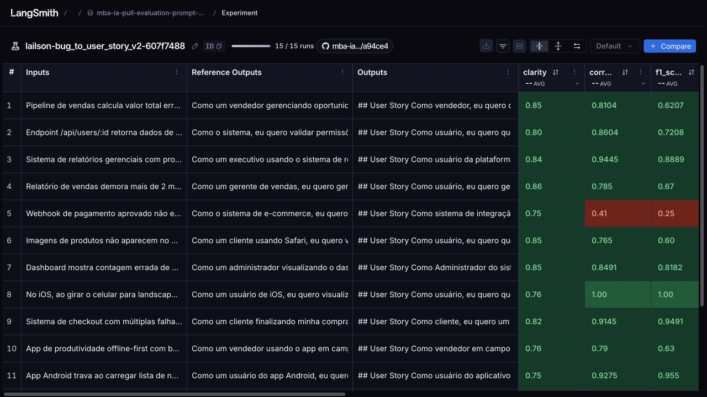

# Revisão manual — Requisito 4

Meta de 0.8 nas cinco médias não atingida. Novas tentativas interrompidas conforme solicitado para revisão manual.

[Dataset e experimentos públicos](https://smith.langchain.com/public/843ce0f5-2616-4911-bfe6-ab30c3f9c85d/d).

## Comparação direta — execução 01 × 09

A execução 09 repete a configuração da 01. O manifesto serializado do prompt é idêntico; o novo hash do Hub identifica a republicação. Os parâmetros de invocação do gerador e dos juízes foram comparados com os traces originais e são idênticos. Não houve ajuste de prompt nem troca de modelo nesta repetição.

| Métrica | Execução 01 | Execução 09 | Diferença (09 − 01) |
| --- | --- | --- | --- |
| helpfulness | 0.8322 | 0.8450 | +0.0128 |
| correctness | 0.8351 | 0.8263 | -0.0088 |
| f1_score | 0.7697 | 0.7632 | -0.0065 |
| clarity | 0.7640 | 0.8007 | +0.0367 |
| precision | 0.9005 | 0.8893 | -0.0112 |
| Média geral | 0.8203 | 0.8249 | +0.0046 |

[Abrir execução 01](https://smith.langchain.com/public/843ce0f5-2616-4911-bfe6-ab30c3f9c85d/d/compare?selectedSessions=6bc79dfe-0ae1-48a9-9c5e-efe28bc8f55a) · [Abrir execução 09](https://smith.langchain.com/public/843ce0f5-2616-4911-bfe6-ab30c3f9c85d/d/compare?selectedSessions=e7039d2f-286d-47e0-a61f-1236bf8542a7).

Mesma configuração não implica respostas ou notas idênticas: são novas chamadas ao gerador e aos juízes. Uma única repetição não permite concluir estabilidade estatística.

### Comparação dos 15 exemplos

| Exemplo | Média das 5 notas na 01 | Média das 5 notas na 09 | Diferença |
| --- | --- | --- | --- |
| App Android trava ao carregar lista de notificações com mais de 50 itens. | 0.8610 | 0.8715 | +0.0105 |
| App de produtividade offline-first com bugs críticos de sincronização. | 0.8106 | 0.7970 | -0.0136 |
| Botão de adicionar ao carrinho não funciona no produto ID 1234. | 0.9550 | 0.8700 | -0.0850 |
| Campo de email aceita texto sem @, permitindo cadastros inválidos. | 0.8500 | 0.8265 | -0.0236 |
| Carrinho permite finalizar compra mesmo com produto fora de estoque. | 0.8126 | 0.7971 | -0.0155 |
| Dashboard mostra contagem errada de usuários ativos. Mostra 50 mas só há 42 na lista. | 0.7240 | 0.8525 | +0.1285 |
| Endpoint /api/users/:id retorna dados de qualquer usuário sem validar permissões. | 0.9430 | 0.8562 | -0.0868 |
| Imagens de produtos não aparecem no Safari. No Chrome funciona normal. | 0.7946 | 0.8070 | +0.0124 |
| Modal de confirmação de exclusão aparece atrás do menu lateral em telas pequenas (< 768px). | 0.7176 | 0.7780 | +0.0603 |
| No iOS, ao girar o celular para landscape, o layout da tela de perfil fica quebrado. | 0.9475 | 0.9280 | -0.0195 |
| Pipeline de vendas calcula valor total errado quando há desconto. | 0.8715 | 0.8412 | -0.0303 |
| Relatório de vendas demora mais de 2 minutos para gerar quando filtro ultrapassa 1000 registros. | 0.7466 | 0.8190 | +0.0724 |
| Sistema de checkout com múltiplas falhas críticas. | 0.7254 | 0.8827 | +0.1573 |
| Sistema de relatórios gerenciais com problemas severos de performance e dados incorretos. | 0.7598 | 0.9187 | +0.1589 |
| Webhook de pagamento aprovado não está sendo chamado. | 0.7850 | 0.5280 | -0.2570 |

[Comparação completa, incluindo respostas e justificativas das duas execuções](iterations/09-comparison.json).

## Resultados medidos

| Iteração | Helpfulness | Correctness | F1 | Clarity | Precision | Média | Aprovado |
| --- | --- | --- | --- | --- | --- | --- | --- |
| [01](iterations/01-results.json) | 0.8322 | 0.8351 | 0.7697 | 0.7640 | 0.9005 | 0.8203 | Não |
| [02](iterations/02-results.json) | 0.8133 | 0.7612 | 0.6718 | 0.7760 | 0.8507 | 0.7746 | Não |
| [03](iterations/03-results.json) | 0.8184 | 0.7762 | 0.6790 | 0.7635 | 0.8733 | 0.7821 | Não |
| [04](iterations/04-results.json) | 0.8378 | 0.7887 | 0.6940 | 0.7922 | 0.8833 | 0.7992 | Não |
| [05](iterations/05-results.json) | 0.7659 | 0.7771 | 0.7395 | 0.7172 | 0.8147 | 0.7629 | Não |
| [06](iterations/06-results.json) | 0.7703 | 0.8064 | 0.7914 | 0.7193 | 0.8213 | 0.7817 | Não |
| [07](iterations/07-results.json) | 0.7982 | 0.8114 | 0.7775 | 0.7510 | 0.8453 | 0.7967 | Não |
| [08](iterations/08-results.json) | 0.7636 | 0.7176 | 0.6384 | 0.7303 | 0.7969 | 0.7294 | Não |
| [09](iterations/09-results.json) | 0.8450 | 0.8263 | 0.7632 | 0.8007 | 0.8893 | 0.8249 | Não |

Cada experimento contém 15 exemplos e 75 notas. A aprovação exige pelo menos 0.8 em cada média; não basta a média geral. O relatório também registra se todas as notas individuais passaram.

## Configuração da última execução

- Experimento: `lailson-bug_to_user_story_v2-607f7488`.
- Commit do prompt: `621ec080979f5c2486b5cfb7abd500587dc1e39fd9343a44627e7da8868d4add`.
- Geração e avaliação: `gpt-5-nano`.
- Parâmetros padrão do provedor nos dois papéis, sem esforço de raciocínio, verbosidade ou modo JSON explícitos.
- Concorrência 1; uma repetição; mesmo comando original `python src/evaluate.py`.
- [Prova das configurações](iterations/09-config.json): manifestos serializados idênticos e os mesmos 15 exemplos.
- O dataset, os textos dos avaliadores e as fórmulas originais não foram alterados.

As configurações do juiz mudaram nas execuções 07 e 08; portanto, diferenças das notas não podem ser atribuídas somente ao prompt. O mesmo conjunto de 15 exemplos orientou os ajustes e a avaliação: não é uma validação independente de generalização.

## Onde revisar

- [Prompt exato utilizado](iterations/09-prompt.yml).
- [Configuração e conferência de identidade](iterations/09-config.json).
- [Relatório completo da última execução](iterations/09-results.json).
- [Snapshots e histórico](iterations/README.md).
- [Executor original usado nesta repetição](../src/evaluate.py).
- [Executor auxiliar das outras iterações](../src/run_iteration.py).
- [Exportação e validação das evidências](../src/export_evaluation.py).

## Casos para inspeção

Os três casos abaixo foram selecionados pelas menores notas individuais da última execução. As justificativas são do juiz e podem conter imprecisões; compare-as com a saída e a referência antes de concluir se a falha é do prompt ou da avaliação.

### 1. Webhook de pagamento aprovado não está sendo chamado.

[Trace público na execução 09](https://smith.langchain.com/public/843ce0f5-2616-4911-bfe6-ab30c3f9c85d/d/compare?selectedSessions=e7039d2f-286d-47e0-a61f-1236bf8542a7&trace=01a14f58-9b57-7d00-b3a8-b2408eba9b3f&peeked_trace_id=01a14f58-9b57-7d00-b3a8-b2408eba9b3f) · [Trace na execução 01](https://smith.langchain.com/public/843ce0f5-2616-4911-bfe6-ab30c3f9c85d/d/compare?selectedSessions=6bc79dfe-0ae1-48a9-9c5e-efe28bc8f55a&trace=01a14d4f-e94c-7963-86b4-d4d0849d8209&peeked_trace_id=01a14d4f-e94c-7963-86b4-d4d0849d8209)

| Execução | Helpfulness | Correctness | F1 | Clarity | Precision |
| --- | --- | --- | --- | --- | --- |
| 01 | 0.8250 | 0.7833 | 0.6667 | 0.7500 | 0.9000 |
| 09 | 0.6600 | 0.4100 | 0.2500 | 0.7500 | 0.5700 |

**Relato**

````text
Webhook de pagamento aprovado não está sendo chamado.

Steps to reproduce:
1. Fazer pedido de R$ 100
2. Pagar com cartão de crédito
3. Pagamento é aprovado no gateway
4. Sistema não recebe notificação
5. Status do pedido fica como "pendente"

Logs do gateway mostram: HTTP 500 ao tentar POST /api/webhooks/payment
````

**Resposta gerada na execução 01**

````markdown
## User Story
Como Sistema de Pedidos, eu quero que o webhook de pagamento aprovado seja chamado corretamente após a aprovação do gateway, para que o pedido seja atualizado do status pendente para refletir que o pagamento foi aprovado e o fluxo de processamento avance.

## Critérios de Aceitação
### Fluxo de sucesso
- Dado que existe um pedido de R$100 criado e pagamento com cartão de crédito foi aprovado pelo gateway
- Quando o webhook de pagamento aprovado é enviado pelo gateway e o POST /api/webhooks/payment é processado com sucesso (200)
- Então o webhook é considerado recebido com sucesso
- E o status do pedido é atualizado para refletir que o pagamento foi aprovado
- E o processamento do pedido avança para o próximo estágio do fluxo de pedido (em curto/mediano prazo)

### Tratamento de falha de webhook (HTTP 500)
- Dado que o gateway envia o webhook de pagamento aprovado e o POST /api/webhooks/payment retorna HTTP 500
- Quando isso ocorre
- Então o sistema registra a falha do webhook e mantém o pedido com status pendente
- E o sistema agenda/reenvia a tentativa de envio do webhook (retry) até obter sucesso
- E, após a reprocessação bem-sucedida, o status do pedido é atualizado para refletir que o pagamento foi aprovado

## Contexto Técnico
- Logs do gateway mostram HTTP 500 ao tentar POST /api/webhooks/payment
- O pedido permanece em pendente enquanto o webhook não é processado com sucesso

## Sugestões Técnicas a Validar
- Garantir idempotência ao processar webhooks para evitar duplicidade de atualização de pedido
- Validar assinatura/autenticidade do webhook recebido
- Implementar retry com backoff (limite de tentativas e intervalo entre retries)
- Garantir que a atualização do pedido ocorra apenas após confirmação bem-sucedida do webhook
- Melhorar observabilidade: correlação entre pedido, webhook e gateway (trace-id, logs ricos)

## Informações a confirmar
- Qual é o formato exato do payload do webhook e quais campos são usados para atualizar o pedido?
- Qual é o estado/valor exato do status do pedido que representa “pagamento aprovado” na prática?
- Qual é a política de retries existente (intervalos, máximo de tentativas) e onde o retry deve ser enfileirado?
- O endpoint /api/webhooks/payment requer autenticação/assinatura específica; quais são os mecanismos esperados?
````

**Resposta gerada na execução 09**

````markdown
## User Story
Como sistema de integração de pagamentos, eu quero que o webhook de pagamento aprovado seja chamado e processado pelo backend assim que o gateway aprova o pagamento, para que o status do pedido seja atualizado de pendente para pago e o fluxo de pagamento seja concluído sem intervenção manual.

## Critérios de Aceitação
### Cenário: processamento bem-sucedido do webhook
- Dado que o pagamento foi aprovado pelo gateway
- Quando o gateway envia POST /api/webhooks/payment com o payload de pagamento aprovado
- Então o endpoint processa o webhook com sucesso e retorna HTTP 200
- E o pedido correspondente tem o status atualizado de "pendente" para "pago"
- E o processamento do webhook é idempotente, de modo que reenviados não causem alterações duplicadas

### Cenário: falha no processamento do webhook (convite a retry)
- Dado que o gateway enviou o webhook com pagamento aprovado e o processamento falhou (por exemplo, HTTP 500)
- Quando o erro é retornado pelo endpoint
- Então o pedido permanece com o status "pendente"
- E o sistema registra o erro e aplica a política de retry/configuração de reprocessamento do webhook
- E, se houver reenviou do webhook, o processamento permanece idempotente

## Contexto Técnico
- Observação: Logs do gateway indicam HTTP 500 ao tentar POST /api/webhooks/payment
- Impacto: o pedido permanece com status pendente até que o webhook seja processado com sucesso

## Sugestões Técnicas a Validar
- Garantir idempotência no processamento de webhooks para evitar alterações duplicadas em envios repetidos
- Verificar assinatura/autenticação do webhook para impedir recebimento de notificações não autorizadas
- Confirmar que o endpoint retorna 2xx apenas após o processamento bem-sucedido
- Definir/validar a política de retries do gateway para chamadas de webhook (intervalos, limites, backoff)
- Melhorar observabilidade: logs detalhados do recebimento, mapeamento entre payload do webhook e pedido, métricas de sucesso/erro por endpoint

## Informações a confirmar
- Campo(es) do payload que identificam o pedido e o pagamento (ex.: id do pedido, id de pagamento, valor)
- Status exato usado pelo sistema para indicar pagamento confirmado/completo (pago, pago, aprovado)
````

**Referência do dataset**

````text
Como o sistema de e-commerce, eu quero receber notificações de pagamento aprovado via webhook, para que o status dos pedidos seja atualizado automaticamente após confirmação do pagamento.

Critérios de Aceitação:
- Dado que um pagamento é aprovado no gateway
- Quando o gateway envia POST para /api/webhooks/payment
- Então o endpoint deve retornar HTTP 200
- E o status do pedido deve mudar de "pendente" para "aprovado"
- E o cliente deve receber email de confirmação
- E o sistema deve logar o evento para auditoria

Contexto Técnico:
- Endpoint está retornando HTTP 500
- Gateway: [nome do gateway de pagamento]
- Logs indicam falha no processamento do webhook
````

**Justificativas do juiz na execução 09, sem edição**

- **f1_score:** A resposta correta inclui apenas o item de sucesso (HTTP 200). Ela erra ao mencionar a transição de status (pendente → pago em vez de 'aprovado'), não aborda explicitamente o envio de email ao cliente nem a logística de auditoria, e adiciona conteúdo não presente na ground truth (idempotência, retries). O contexto de falha HTTP 500 é citado, mas não compensa as falhas nas demais regras.
- **clarity:** A organização é boa: seções claras (User Story, Critérios, Contexto, Sugestões, Informações a confirmar). A linguagem é direta em PT-BR, com termos técnicos adequados. No entanto, há ambiguidade potencial em termos de estados (pendente/pago/aprovado) e a relação entre o esperado e a falha (HTTP 500) poderia ser mais explícita. A resposta é relativamente longa; poderia ser mais concisa sem perder informações essenciais. Em resumo, clareza boa, com pequenas oportunidades de simplificação e alinhamento de termos.
- **precision:** A resposta é parcialmente relevante ao tema de webhooks, mas diverge do ground truth. Divergências-chave: usa o status final 'pago' em vez de 'aprovado' e não menciona envio de email ao cliente nem logs para auditoria. Adiciona cenários de retry e idempotência, que não eram estritamente solicitados. Embora trate de sucesso/falha no processamento e HTTP 200, a inconsistência de status e a omissão de notificações/auditoria reduzem a precisão em relação à referência. Em resumo, contém alocação útil, porém não está alinhada integralmente com o cenário esperado.

### 2. Imagens de produtos não aparecem no Safari. No Chrome funciona normal.

[Trace público na execução 09](https://smith.langchain.com/public/843ce0f5-2616-4911-bfe6-ab30c3f9c85d/d/compare?selectedSessions=e7039d2f-286d-47e0-a61f-1236bf8542a7&trace=01a14f58-ee29-7ce0-963b-9f781fd64f45&peeked_trace_id=01a14f58-ee29-7ce0-963b-9f781fd64f45) · [Trace na execução 01](https://smith.langchain.com/public/843ce0f5-2616-4911-bfe6-ab30c3f9c85d/d/compare?selectedSessions=6bc79dfe-0ae1-48a9-9c5e-efe28bc8f55a&trace=01a14d50-4620-7f12-a4c9-98aac8306995&peeked_trace_id=01a14d50-4620-7f12-a4c9-98aac8306995)

| Execução | Helpfulness | Correctness | F1 | Clarity | Precision |
| --- | --- | --- | --- | --- | --- |
| 01 | 0.7625 | 0.8286 | 0.8571 | 0.7250 | 0.8000 |
| 09 | 0.8900 | 0.7650 | 0.6000 | 0.8500 | 0.9300 |

**Relato**

````text
Imagens de produtos não aparecem no Safari. No Chrome funciona normal.
````

**Resposta gerada na execução 01**

````markdown
## User Story
Como usuário de loja online, eu quero que as imagens dos produtos apareçam no Safari, para que eu possa avaliar os itens da mesma forma que no Chrome.

## Critérios de Aceitação
### Compatibilidade entre navegadores
- Dado que estou na página de um produto acessada pelo Safari
- Quando a página é carregada
- Então a imagem do produto é exibida e carrega corretamente no Safari

- Dado que estou na mesma página de produto acessada pelo Chrome
- Quando a página é carregada
- Então a imagem do produto é exibida e carrega corretamente no Chrome
````

**Resposta gerada na execução 09**

````markdown
## User Story
Como usuário, eu quero que as imagens dos produtos apareçam no Safari, para que eu possa visualizar corretamente os produtos, assim como ocorre no Chrome.

## Critérios de Aceitação
- Dado que estou usando o Safari e estou na página de listagem de produtos
- Quando a página carrega
- Então as imagens de todos os produtos aparecem, sem falhas de carregamento, com aparência idêntica às imagens exibidas no Chrome
````

**Referência do dataset**

````text
Como um cliente usando Safari, eu quero visualizar as imagens dos produtos, para que eu possa avaliar os itens antes de comprar.

Critérios de Aceitação:
- Dado que estou navegando em um navegador Safari
- Quando acesso a página de um produto
- Então as imagens do produto devem carregar corretamente
- E devem ter a mesma qualidade que em outros navegadores
- E o tempo de carregamento deve ser similar
````

**Justificativas do juiz na execução 09, sem edição**

- **f1_score:** A resposta gerada mantém o foco no Safari e na necessidade de as imagens dos produtos carregarem sem falhas e com aparência comparable aos Chrome. Entretanto, ela descreve a página como a de listagem de produtos em vez da página de um produto, o que contraria o objetivo da Ground Truth. Além disso, não menciona explicitamente o tempo de carregamento similar (critério de aceitação ausente). Assim, 3 de 5 itens corretos/presentes, resultando em precisão e recall de 0.6.
- **clarity:** Organização: boa, com seções distintas (User Story; Critérios de Aceitação) que guiam a leitura; o uso de markdown é opcional, mas não prejudica a clareza. Linguagem: simples, direta, sem jargões. Ausência de ambiguidade: descreve o cenário (Safari, página de listagem) e o resultado esperado (imagens carregando sem falha, com aparência equivalente ao Chrome). Concisão: suficiente, sem redundâncias; poderia ser mais enxuta removendo os rótulos de seção para reduzir tamanho, mas as informações essenciais estão presentes.
- **precision:** AUSÊNCIA DE ALUCINAÇÕES: não há afirmações factuais incorretas; trata-se de uma user story genérica. FOCO NA PERGUNTA: foca em Safari e paridade com Chrome, mas desvia do pedido original ao mencionar a página de listagem em vez da página de produto, e não sugere passos de solução. CORREÇÃO FACTUAL: não há erros verificáveis; o conteúdo é conceitual e não contradiz fatos observáveis. Observação: não aborda o tempo de carregamento, que era parte da ground truth.

### 3. Pipeline de vendas calcula valor total errado quando há desconto.

[Trace público na execução 09](https://smith.langchain.com/public/843ce0f5-2616-4911-bfe6-ab30c3f9c85d/d/compare?selectedSessions=e7039d2f-286d-47e0-a61f-1236bf8542a7&trace=01a14f57-ca29-75a0-83c5-95c4805f0cb1&peeked_trace_id=01a14f57-ca29-75a0-83c5-95c4805f0cb1) · [Trace na execução 01](https://smith.langchain.com/public/843ce0f5-2616-4911-bfe6-ab30c3f9c85d/d/compare?selectedSessions=6bc79dfe-0ae1-48a9-9c5e-efe28bc8f55a&trace=01a14d4e-f47f-71a0-8ac2-e2cf71b4d709&peeked_trace_id=01a14d4e-f47f-71a0-8ac2-e2cf71b4d709)

| Execução | Helpfulness | Correctness | F1 | Clarity | Precision |
| --- | --- | --- | --- | --- | --- |
| 01 | 0.9125 | 0.8734 | 0.7467 | 0.8250 | 1.0000 |
| 09 | 0.9250 | 0.8104 | 0.6207 | 0.8500 | 1.0000 |

**Relato**

````text
Pipeline de vendas calcula valor total errado quando há desconto.

Cenário:
- Produto A: R$ 1.000
- Produto B: R$ 500
- Desconto: 10%
- Valor esperado: R$ 1.350
- Valor mostrado: R$ 1.400

O sistema aplica desconto só no primeiro produto.
````

**Resposta gerada na execução 01**

````markdown
## User Story
Como vendedor, eu quero que o pipeline de vendas aplique o desconto de forma correta ao total dos itens, para que o valor final reflita o desconto sobre a soma dos itens e não apenas sobre o primeiro item.

## Critérios de Aceitação
### Cenário de correção do cálculo de desconto
- Dado que produto A tem preço R$ 1.000, produto B tem preço R$ 500 e há um desconto de 10% aplicado
- Quando o total é calculado
- Então o total exibido deve ser R$ 1.350
- E o desconto de 10% deve ser aplicado à soma dos itens

### Cenário de regressão (verificação do bug atual)
- Dado que o mesmo cenário (A: R$ 1.000; B: R$ 500; Desconto: 10%)
- Quando o cálculo é feito e o sistema aplica o desconto apenas ao primeiro item
- Então o total exibido não deve ser R$ 1.400; o resultado esperado continua sendo R$ 1.350

## Contexto Técnico
- O relato evidencia que o desconto está sendo aplicado apenas ao primeiro item, resultando em R$ 1.400 (em vez de R$ 1.350) no exemplo fornecido.
- A correção envolve aplicar o desconto à soma total dos itens, ou seja, totalItens × (1 - desconto).

## Sugestões Técnicas a Validar
- Garantir que o desconto percentual seja aplicado à soma de todos os itens do pedido, não a itens individuais.
- Adicionar testes de integração/unitários cobrindo cenários com múltiplos itens e descontos percentuais.
- Validar que o valor exibido na interface corresponde ao cálculo do total com o desconto aplicado à soma dos itens.
````

**Resposta gerada na execução 09**

````markdown
## User Story
Como vendedor, eu quero que o pipeline de vendas aplique o desconto de 10% sobre o total da venda (somatório dos itens), para que o valor final reflita corretamente o desconto em todos os itens (ex.: venda com A = R$1.000 e B = R$500 deve retornar R$1.350).

## Critérios de Aceitação
- Dado que a venda contém os itens A (R$ 1.000) e B (R$ 500) e o desconto de 10%
- Quando o pipeline processa a venda com desconto
- Então o valor total exibido deve ser R$ 1.350
- E o desconto deve ser aplicado ao total (somatório), não apenas ao primeiro item
````

**Referência do dataset**

````text
Como um vendedor gerenciando oportunidades no pipeline, eu quero que o valor total seja calculado corretamente quando aplico descontos, para que eu possa apresentar propostas precisas aos clientes.

Critérios de Aceitação:
- Dado que tenho uma oportunidade com múltiplos produtos
- Quando aplico um desconto percentual
- Então o desconto deve ser aplicado no valor total de todos os produtos
- E o valor final deve ser: (soma dos produtos) × (1 - desconto%)
- E o detalhamento deve mostrar: subtotal, desconto e total

Exemplo de Cálculo:
- Produto A: R$ 1.000
- Produto B: R$ 500
- Subtotal: R$ 1.500
- Desconto 10%: -R$ 150
- Total: R$ 1.350

Contexto Técnico:
- Bug atual: desconto sendo aplicado apenas no primeiro produto
- Resultado incorreto: R$ 1.400 (deveria ser R$ 1.350)
````

**Justificativas do juiz na execução 09, sem edição**

- **f1_score:** Precisão: todas as informações apresentadas são corretas e relevantes (aplicar desconto no total, exemplo com A=1.000 e B=500, resultado 1.350, desconto sobre o total). Recall: o Ground Truth exige detalhamento (subtotal, desconto e total), fórmula explícita (soma dos produtos × (1 - desconto%)) e contexto técnico do bug; esse conteúdo não está presente na resposta, reduzindo o recall. Em resumo: correto e relevante, porém incompleto em termos de detalhamento exigido.
- **clarity:** Organização: boa, com seções claras (história do usuário e critérios de aceitação). Linguagem: direta e de fácil compreensão. Ausência de Ambiguidade: fica claro que a aplicação é no total da venda; o exemplo ajuda. Concisão: em geral é concisa, mas há duplicação de conteúdo ao incluir uma seção de referência, o que pode confundir. Observação adicional: a notação R$ 1.350 é compreensível para quem conhece o formato brasileiro, embora a formatação de moeda possa variar entre leitores.
- **precision:** A resposta não contém alucinações e está estritamente alinhada ao problema proposto: aplica o desconto ao total (somatório) e usa o exemplo A=1000, B=500 resultando em 1.350. O foco é direto na correção do cálculo de desconto sobre o total, sem digressões, e a afirmação factual (desconto de 10% sobre o total) está correta segundo o cenário.

## Inconsistência observada em uma execução anterior

Na execução 07, o caso de webhook contém HTTP 200 e registro de auditoria. O juiz de Precision afirma que esses itens estão ausentes e atribui 0.32. Há também uma divergência real no status: a saída usa "pago", enquanto a referência usa "aprovado". A nota foi preservada, sem ajuste manual.

[Conferir o relatório 07](iterations/07-results.json).


## Captura da execução 09


