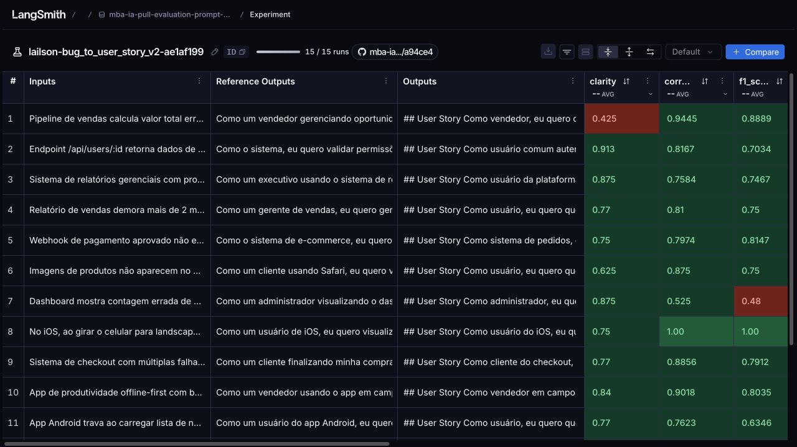

# Revisão manual — execução 10

A meta de 0.8 em cada uma das cinco médias não foi atingida.

Foi realizada uma única nova avaliação após autorização. Nenhuma tentativa adicional foi iniciada. O requisito 5 permanece pendente.

[Execução 10 no LangSmith](https://smith.langchain.com/public/843ce0f5-2616-4911-bfe6-ab30c3f9c85d/d/compare?selectedSessions=81235e0f-3a73-45a9-8170-7eed8fcf1cc4) · [Execução 09](https://smith.langchain.com/public/843ce0f5-2616-4911-bfe6-ab30c3f9c85d/d/compare?selectedSessions=e7039d2f-286d-47e0-a61f-1236bf8542a7) · [Execução 01](https://smith.langchain.com/public/843ce0f5-2616-4911-bfe6-ab30c3f9c85d/d/compare?selectedSessions=6bc79dfe-0ae1-48a9-9c5e-efe28bc8f55a) · [Prompt público](https://smith.langchain.com/hub/lailson/bug_to_user_story_v2).

## Mudanças e configuração

- Preservar os estados e a transição de "pendente" para "aprovado" após confirmação do pagamento pelo webhook, sem trocar o destino por "pago".
- Evitar idempotência, retries e outros requisitos sem suporte no relato.
- Condicionar as orientações de integração e concorrência ao problema relatado.
- Mesmos modelos `gpt-5-nano` na geração e nos juízes, parâmetros padrão do provedor, concorrência 1 e uma repetição.
- Mesmo executor original, dataset de 15 exemplos, avaliadores, fórmulas e limite de aprovação. A alteração foi no prompt.
- Commit publicado: `c7474269af12399be238bc1fffe3f3c64478d2038a53c4321f481bc73da3d518`.

[Prompt utilizado](iterations/10-prompt.yml) · [Diff exato](iterations/10-prompt.diff) · [Configuração conferida](iterations/10-config.json).

## Comparação das médias

| Métrica | Execução 01 | Execução 09 | Execução 10 | Diferença 10 − 09 |
| --- | --- | --- | --- | --- |
| helpfulness | 0.8322 | 0.8450 | 0.8344 | -0.0106 |
| correctness | 0.8351 | 0.8263 | 0.8325 | +0.0062 |
| f1_score | 0.7697 | 0.7632 | 0.7702 | +0.0070 |
| clarity | 0.7640 | 0.8007 | 0.7742 | -0.0265 |
| precision | 0.9005 | 0.8893 | 0.8947 | +0.0054 |
| Média geral | 0.8203 | 0.8249 | 0.8212 | -0.0037 |

A aprovação exige pelo menos 0.8 em cada média, não apenas na média geral. Cada execução contém 75 notas. Uma única avaliação não isola a variação dos modelos nem demonstra ganho estatisticamente consistente. O prompt foi ajustado com base neste dataset; não há validação independente de generalização.

## Comparação dos 15 exemplos

| Exemplo | F1 na 09 | F1 na 10 | Diferença F1 | Média na 09 | Média na 10 |
| --- | --- | --- | --- | --- | --- |
| App Android trava ao carregar lista de notificações com mais de 50 itens. | 0.9550 | 0.6346 | -0.3204 | 0.8715 | 0.7774 |
| App de produtividade offline-first com bugs críticos de sincronização. | 0.6300 | 0.8035 | +0.1735 | 0.7970 | 0.8931 |
| Botão de adicionar ao carrinho não funciona no produto ID 1234. | 1.0000 | 1.0000 | +0.0000 | 0.8700 | 0.9470 |
| Campo de email aceita texto sem @, permitindo cadastros inválidos. | 0.8182 | 0.8163 | -0.0019 | 0.8265 | 0.9094 |
| Carrinho permite finalizar compra mesmo com produto fora de estoque. | 0.8571 | 0.7200 | -0.1371 | 0.7971 | 0.7555 |
| Dashboard mostra contagem errada de usuários ativos. Mostra 50 mas só há 42 na lista. | 0.8182 | 0.4800 | -0.3382 | 0.8525 | 0.6345 |
| Endpoint /api/users/:id retorna dados de qualquer usuário sem validar permissões. | 0.7208 | 0.7034 | -0.0174 | 0.8562 | 0.8569 |
| Imagens de produtos não aparecem no Safari. No Chrome funciona normal. | 0.6000 | 0.7500 | +0.1500 | 0.8070 | 0.8125 |
| Modal de confirmação de exclusão aparece atrás do menu lateral em telas pequenas (< 768px). | 0.6699 | 0.6541 | -0.0158 | 0.7780 | 0.7722 |
| No iOS, ao girar o celular para landscape, o layout da tela de perfil fica quebrado. | 1.0000 | 1.0000 | +0.0000 | 0.9280 | 0.9250 |
| Pipeline de vendas calcula valor total errado quando há desconto. | 0.6207 | 0.8889 | +0.2682 | 0.8412 | 0.7942 |
| Relatório de vendas demora mais de 2 minutos para gerar quando filtro ultrapassa 1000 registros. | 0.6700 | 0.7500 | +0.0800 | 0.8190 | 0.8040 |
| Sistema de checkout com múltiplas falhas críticas. | 0.9491 | 0.7912 | -0.1579 | 0.8827 | 0.8604 |
| Sistema de relatórios gerenciais com problemas severos de performance e dados incorretos. | 0.8889 | 0.7467 | -0.1422 | 0.9187 | 0.7945 |
| Webhook de pagamento aprovado não está sendo chamado. | 0.2500 | 0.8147 | +0.5647 | 0.5280 | 0.7814 |

[Comparação completa: respostas, referências, notas, justificativas e traces dos 15 exemplos](iterations/10-comparison.json).

## Casos para inspeção

O primeiro caso é o webhook que motivou o ajuste. Os outros dois são os menores F1 da nova execução entre os casos restantes. As justificativas abaixo são transcritas sem edição e devem ser confrontadas com a saída e a referência.

**Observação manual sobre o webhook:** a resposta usa a transição "pendente" → "aprovado", mas ainda acrescenta retry automático, fila e idempotência nas sugestões técnicas. Portanto, a adesão às novas orientações foi parcial. Essa observação não altera nenhuma nota do juiz.

### 1. Webhook de pagamento aprovado não está sendo chamado.

[Trace 09](https://smith.langchain.com/public/843ce0f5-2616-4911-bfe6-ab30c3f9c85d/d/compare?selectedSessions=e7039d2f-286d-47e0-a61f-1236bf8542a7&trace=01a14f58-9b57-7d00-b3a8-b2408eba9b3f&peeked_trace_id=01a14f58-9b57-7d00-b3a8-b2408eba9b3f) · [Trace 10](https://smith.langchain.com/public/843ce0f5-2616-4911-bfe6-ab30c3f9c85d/d/compare?selectedSessions=81235e0f-3a73-45a9-8170-7eed8fcf1cc4&trace=01a14fd9-f10f-7ff1-b43a-ff5c47b9c136&peeked_trace_id=01a14fd9-f10f-7ff1-b43a-ff5c47b9c136)

| Execução | Helpfulness | Correctness | F1 | Clarity | Precision |
| --- | --- | --- | --- | --- | --- |
| 09 | 0.6600 | 0.4100 | 0.2500 | 0.7500 | 0.5700 |
| 10 | 0.7650 | 0.7974 | 0.8147 | 0.7500 | 0.7800 |

**Relato**

````text
Webhook de pagamento aprovado não está sendo chamado.

Steps to reproduce:
1. Fazer pedido de R$ 100
2. Pagar com cartão de crédito
3. Pagamento é aprovado no gateway
4. Sistema não recebe notificação
5. Status do pedido fica como "pendente"

Logs do gateway mostram: HTTP 500 ao tentar POST /api/webhooks/payment
````

**Resposta da execução 09**

````text
## User Story
Como sistema de integração de pagamentos, eu quero que o webhook de pagamento aprovado seja chamado e processado pelo backend assim que o gateway aprova o pagamento, para que o status do pedido seja atualizado de pendente para pago e o fluxo de pagamento seja concluído sem intervenção manual.

## Critérios de Aceitação
### Cenário: processamento bem-sucedido do webhook
- Dado que o pagamento foi aprovado pelo gateway
- Quando o gateway envia POST /api/webhooks/payment com o payload de pagamento aprovado
- Então o endpoint processa o webhook com sucesso e retorna HTTP 200
- E o pedido correspondente tem o status atualizado de "pendente" para "pago"
- E o processamento do webhook é idempotente, de modo que reenviados não causem alterações duplicadas

### Cenário: falha no processamento do webhook (convite a retry)
- Dado que o gateway enviou o webhook com pagamento aprovado e o processamento falhou (por exemplo, HTTP 500)
- Quando o erro é retornado pelo endpoint
- Então o pedido permanece com o status "pendente"
- E o sistema registra o erro e aplica a política de retry/configuração de reprocessamento do webhook
- E, se houver reenviou do webhook, o processamento permanece idempotente

## Contexto Técnico
- Observação: Logs do gateway indicam HTTP 500 ao tentar POST /api/webhooks/payment
- Impacto: o pedido permanece com status pendente até que o webhook seja processado com sucesso

## Sugestões Técnicas a Validar
- Garantir idempotência no processamento de webhooks para evitar alterações duplicadas em envios repetidos
- Verificar assinatura/autenticação do webhook para impedir recebimento de notificações não autorizadas
- Confirmar que o endpoint retorna 2xx apenas após o processamento bem-sucedido
- Definir/validar a política de retries do gateway para chamadas de webhook (intervalos, limites, backoff)
- Melhorar observabilidade: logs detalhados do recebimento, mapeamento entre payload do webhook e pedido, métricas de sucesso/erro por endpoint

## Informações a confirmar
- Campo(es) do payload que identificam o pedido e o pagamento (ex.: id do pedido, id de pagamento, valor)
- Status exato usado pelo sistema para indicar pagamento confirmado/completo (pago, pago, aprovado)
````

**Resposta da execução 10**

````text
## User Story
Como sistema de pedidos, eu quero que o webhook de pagamento aprovado seja recebido pelo endpoint /api/webhooks/payment, para que o status do pedido seja atualizado de "pendente" para "aprovado" assim que o gateway confirmar o pagamento.

## Critérios de Aceitação
### Sucesso do processamento do webhook
- Dado que existe um pedido com status pendente devido à confirmação de pagamento
- E o gateway envia o webhook de pagamento aprovado para /api/webhooks/payment
- Quando o processamento desse webhook é concluído com sucesso pelo sistema
- Então o status do pedido muda de "pendente" para "aprovado" e o registro de pagamento fica vinculado ao pedido

### Falha no processamento do webhook (HTTP 500)
- Dado que o gateway envia o webhook para /api/webhooks/payment e o processamento retorna HTTP 500
- Quando ocorre essa falha
- Então o pedido permanece em "pendente"
- E o sistema registra a falha para retrabalho/reprocessamento futuro (incluindo identificadores relevantes, como ID do pagamento e timestamp)

## Contexto Técnico
- O gateway de pagamentos envia um webhook de pagamento aprovado para /api/webhooks/payment.
- Logs do gateway mostram HTTP 500 ao tentar POST /api/webhooks/payment, impedindo o processamento adequado pelo sistema.
- Consequência observável: o pedido permanece com status "pendente".

## Sugestões Técnicas a Validar
- Tratar falhas 5xx no processamento de webhooks, com retry automático ou fila para garantir que o webhook seja processado mesmo após falha transitória.
- Garantir que a transição de status ocorra apenas após processamento bem-sucedido do webhook; não depender apenas da confirmação do gateway.
- Implementar idempotência para o endpoint /api/webhooks/payment para evitar mudanças duplicadas ou inconsistentes caso o gateway reenvie o webhook.
- Registrar logs detalhados (payload relevante, IDs de pedido e evento, timestamp) para facilitar diagnóstico e auditoria.
- Validar que, quando o webhook é processado com sucesso, o pedido atualize corretamente para "aprovado" e o pagamento seja registrado no pedido.
````

**Referência do dataset**

````text
Como o sistema de e-commerce, eu quero receber notificações de pagamento aprovado via webhook, para que o status dos pedidos seja atualizado automaticamente após confirmação do pagamento.

Critérios de Aceitação:
- Dado que um pagamento é aprovado no gateway
- Quando o gateway envia POST para /api/webhooks/payment
- Então o endpoint deve retornar HTTP 200
- E o status do pedido deve mudar de "pendente" para "aprovado"
- E o cliente deve receber email de confirmação
- E o sistema deve logar o evento para auditoria

Contexto Técnico:
- Endpoint está retornando HTTP 500
- Gateway: [nome do gateway de pagamento]
- Logs indicam falha no processamento do webhook
````

**Justificativas do juiz na execução 09, sem edição**

- **f1_score:** A resposta correta inclui apenas o item de sucesso (HTTP 200). Ela erra ao mencionar a transição de status (pendente → pago em vez de 'aprovado'), não aborda explicitamente o envio de email ao cliente nem a logística de auditoria, e adiciona conteúdo não presente na ground truth (idempotência, retries). O contexto de falha HTTP 500 é citado, mas não compensa as falhas nas demais regras.
- **clarity:** A organização é boa: seções claras (User Story, Critérios, Contexto, Sugestões, Informações a confirmar). A linguagem é direta em PT-BR, com termos técnicos adequados. No entanto, há ambiguidade potencial em termos de estados (pendente/pago/aprovado) e a relação entre o esperado e a falha (HTTP 500) poderia ser mais explícita. A resposta é relativamente longa; poderia ser mais concisa sem perder informações essenciais. Em resumo, clareza boa, com pequenas oportunidades de simplificação e alinhamento de termos.
- **precision:** A resposta é parcialmente relevante ao tema de webhooks, mas diverge do ground truth. Divergências-chave: usa o status final 'pago' em vez de 'aprovado' e não menciona envio de email ao cliente nem logs para auditoria. Adiciona cenários de retry e idempotência, que não eram estritamente solicitados. Embora trate de sucesso/falha no processamento e HTTP 200, a inconsistência de status e a omissão de notificações/auditoria reduzem a precisão em relação à referência. Em resumo, contém alocação útil, porém não está alinhada integralmente com o cenário esperado.

**Justificativas do juiz na execução 10, sem edição**

- **f1_score:** A resposta cobre o objetivo principal (notificar via webhook e atualizar o status) e critérios-chave (POST para /api/webhooks/payment, mudança de pendente para aprovado, tratamento de falha HTTP 500). Falta mencionar explicitamente HTTP 200 e o envio de e-mail ao cliente, além de deixar explícito o log para auditoria. Inclui ainda sugestões técnicas úteis (retry, idempotência, logs) e menciona ligar o pagamento ao pedido, o que é relevante. Em conjunto, a resposta é majoritariamente correta e relevante, com algumas omissões importantes relativas aos critérios de aceitação estritos.
- **clarity:** Organização: boa estrutura com seções claras (User Story, Critérios, Contexto, Sugestões). Linguagem: técnica, acessível, porém com jargões comuns de API que exigem conhecimento; não é excessivamente confusa. Ausência de ambiguidade: ações esperadas são explícitas, mas o fluxo de retries/ idempotência não é completamente detalhado. Concisão: suficiente para compreensão, porém relativamente extensa por incluir várias subseções; poderia ser mais enxuta sem perder informação essencial. Em geral, clareza adequada com espaço para tornar mais direto e reduzir repetição.
- **precision:** 1) AUSÊNCIA DE ALUCINAÇÕES: não há informações claramente inventadas; menciona HTTP 500 ao POST /api/webhooks/payment e pendência, o que corresponde ao problema descrito. Porém, não cita explicitamente retorno HTTP 200 ou envio de e-mail ao cliente, itens do Ground Truth. 2) FOCO NA PERGUNTA: o texto permanece no tema de webhook de pagamento e cenários de sucesso/falha, incluindo retry e idempotência; mas não responde exatamente ao porquê o webhook não está sendo chamado nem aborda o requisito de resposta 200 no sucesso. 3) CORREÇÃO FACTUAL: alinha-se ao evento de falha 500 e pendência, porém falha ao cobrir requisitos factuais do Ground Truth (retorno 200 no sucesso e notificação por e-mail).

### 2. Dashboard mostra contagem errada de usuários ativos. Mostra 50 mas só há 42 na lista.

[Trace 09](https://smith.langchain.com/public/843ce0f5-2616-4911-bfe6-ab30c3f9c85d/d/compare?selectedSessions=e7039d2f-286d-47e0-a61f-1236bf8542a7&trace=01a14f59-0bc3-7de1-8f51-1fb76da9bc6d&peeked_trace_id=01a14f59-0bc3-7de1-8f51-1fb76da9bc6d) · [Trace 10](https://smith.langchain.com/public/843ce0f5-2616-4911-bfe6-ab30c3f9c85d/d/compare?selectedSessions=81235e0f-3a73-45a9-8170-7eed8fcf1cc4&trace=01a14fda-6f64-7da0-8ea3-ea26e8a5c258&peeked_trace_id=01a14fda-6f64-7da0-8ea3-ea26e8a5c258)

| Execução | Helpfulness | Correctness | F1 | Clarity | Precision |
| --- | --- | --- | --- | --- | --- |
| 09 | 0.8650 | 0.8491 | 0.8182 | 0.8500 | 0.8800 |
| 10 | 0.7225 | 0.5250 | 0.4800 | 0.8750 | 0.5700 |

**Relato**

````text
Dashboard mostra contagem errada de usuários ativos. Mostra 50 mas só há 42 na lista.
````

**Resposta da execução 09**

````text
## User Story
Como Administrador do sistema, eu quero que a contagem de usuários ativos exibida no dashboard seja consistente com a lista de usuários ativos apresentada, para que eu possa confiar no número mostrado ao gerenciar a base de usuários.

## Critérios de Aceitação
### Cenário 1: Contagem reflete a lista ao carregar
- Dado que a lista de usuários ativos exibidos contém 42 itens
- Quando o dashboard é carregado
- Então a contagem de usuários ativos exibida deve ser 42
- E a lista exibida contém exatamente 42 usuários ativos

### Cenário 2: Correção de discrepância entre contagem e lista
- Dado que a contagem exibida no dashboard está 50, enquanto a lista mostra 42 usuários ativos
- Quando o dashboard carrega ou sincroniza os dados
- Então a contagem exibida é atualizada para 42
- E a lista permanece com 42 usuários ativos

## Sugestões Técnicas a Validar
- Verificar a origem da contagem de ativos: se está derivando da fonte correta ou de cache desatualizado.
- Garantir atomicidade entre a obtenção da lista e a contagem apresentada.
- Implementar validação na UI para recalcular a contagem com base no tamanho da lista ou, pelo menos, alinhar a contagem com o conjunto exibido após carregamento.
- Validar cenários de paginação ou filtros para garantir que a contagem reflita apenas os itens visíveis/ativos conforme aplicado.
````

**Resposta da execução 10**

````text
## User Story
Como administrador, eu quero que a contagem de usuários ativos no Dashboard reflita exatamente o número de usuários ativos exibidos na lista, para que eu possa tomar decisões com base no número real de usuários ativos.

## Critérios de Aceitação
### Divergência entre contagem e lista
- Dado que estou no Dashboard de Usuários
- E a lista de usuários ativos exibida contém 42 itens
- Quando a contagem de usuários ativos exibida é 50
- Então a contagem de usuários ativos exibida deve ser igual a 42
````

**Referência do dataset**

````text
Como um administrador visualizando o dashboard, eu quero ver a contagem correta de usuários ativos, para que eu possa tomar decisões baseadas em dados precisos.

Critérios de Aceitação:
- Dado que acesso o dashboard como admin
- Quando visualizo a métrica de usuários ativos
- Então o número exibido deve corresponder ao total real de usuários ativos
- E o valor deve ser atualizado em tempo real
- E deve incluir apenas usuários com status "ativo
````

**Justificativas do juiz na execução 09, sem edição**

- **f1_score:** A resposta gerada está alinhada ao objetivo da ground truth: contagem de ativos correta para admin e atualização ao carregar/sincronizar, cobrindo a maioria dos critérios (correspondência com a lista, correção de discrepância, atualização de dados). Falha leve ao não usar explicitamente a expressão 'em tempo real', embora a ideia de atualização contínua seja presumível via carregamento/sincronização. Conteúdo técnico adicional é relevante, mas não contradiz os requisitos.
- **clarity:** Organização: boa, com seções claras (User Story, Critérios, Sugestões Técnicas). Linguagem: simples e direta. Ausência de ambiguidade: comunica bem que a contagem deve refletir a lista e sincronizar ao carregar/ atualizar; poderia esclarecer paginação/filtros. Concisão: prática, mas poderia ser mais objetiva, reduzindo repetições. Em conjunto, a resposta é clara e útil para validação de consistência entre a lista de ativos e a contagem.
- **precision:** A resposta não introduz alucinações: utiliza o problema (contagem 50 vs lista 42) e propõe uma solução com cenários de carregamento/sincronização para fazer a contagem refletir a lista. Mantém foco no objetivo de correção de discrepâncias entre contagem e itens exibidos. Não há afirmações factuais falsas. Contudo, embora trate de sincronização, não enfatiza explicitamente atualização em tempo real nem o filtro/exclusão de itens que não estejam com status 'ativo', conforme Ground Truth. Em geral, é relevante, mas esses pontos poderiam ficar mais explícitos.

**Justificativas do juiz na execução 10, sem edição**

- **f1_score:** A resposta reproduz a User Story com objetivo de refletir a contagem de ativos para decisões baseadas em dados (correto). Ela também apresenta um critério de aceitação com Divergência entre a contagem e a lista, usando 50 vs 42 e exigindo que a contagem corresponda a 42 (correto). Contudo, não há menção explícita à atualização em tempo real nem reforço claro de incluir apenas usuários com status ativo nos critérios (embora a lista use termos de ativos). Portanto, 3 de 5 itens estão presentes.
- **clarity:** Organização: boa, com User Story e Critérios de Aceitação. Linguagem: clara e direta. Ausência de Ambiguidade: comunicação é clara sobre a necessidade de igualar a contagem à lista; porém não define se deve atualizar em tempo real nem reforça o filtro de status nos critérios. Concisão: objetiva, sem redundâncias. Em geral, a clareza é boa, mas sugeriria clarificar atualização em tempo real e inclusão explícita do status ativo para evitar dúvidas futuras.
- **precision:** A resposta está parcialmente alinhada com o problema (divergência entre contagem e lista) ao apresentar uma User Story para corrigir a contagem. No entanto, falha em atender completamente os critérios desejados no Ground Truth ao não mencionar explicitamente atualização em tempo real e filtragem por status ativo. Além disso, introduz um cenário específico (42 vs 50) que, embora relevante, não substitui as diretrizes mais gerais. Não parece haver alegações factualmente incorretas graves, mas há lacunas de requisitos que reduzem a precisão completa.

### 3. App Android trava ao carregar lista de notificações com mais de 50 itens.

[Trace 09](https://smith.langchain.com/public/843ce0f5-2616-4911-bfe6-ab30c3f9c85d/d/compare?selectedSessions=e7039d2f-286d-47e0-a61f-1236bf8542a7&trace=01a14f57-7897-7d93-8c93-1087698a9b01&peeked_trace_id=01a14f57-7897-7d93-8c93-1087698a9b01) · [Trace 10](https://smith.langchain.com/public/843ce0f5-2616-4911-bfe6-ab30c3f9c85d/d/compare?selectedSessions=81235e0f-3a73-45a9-8170-7eed8fcf1cc4&trace=01a14fd8-d37c-7d70-aead-1d52636770ce&peeked_trace_id=01a14fd8-d37c-7d70-aead-1d52636770ce)

| Execução | Helpfulness | Correctness | F1 | Clarity | Precision |
| --- | --- | --- | --- | --- | --- |
| 09 | 0.8250 | 0.9275 | 0.9550 | 0.7500 | 0.9000 |
| 10 | 0.8300 | 0.7623 | 0.6346 | 0.7700 | 0.8900 |

**Relato**

````text
App Android trava ao carregar lista de notificações com mais de 50 itens.

Observações:
- Tela fica congelada por 5-10 segundos
- ANR (Application Not Responding) em alguns casos
- Lista não está usando paginação
- Carrega tudo de uma vez na Thread principal
````

**Resposta da execução 09**

````text
## User Story
Como usuário do aplicativo Android, eu quero que a lista de notificações seja carregada de forma paginada e em background, para que eu possa navegar pela lista sem travamentos, sem ANR, mesmo quando houver mais de 50 itens.

## Critérios de Aceitação
### Carregamento inicial
- Dado que a tela de notificações contém mais de 50 itens
- Quando a tela é aberta
- Então o carregamento é iniciado em uma thread de background
- E a interface exibe um indicador de carregamento
- E as primeiras notificações aparecem sem travamento perceptível da UI

### Paginação / Carregamento sob demanda
- Dado que as notificações foram carregadas em tela com mais de 50 itens
- Quando o usuário rola até o fim ou aciona o carregamento adicional
- Então as notificações seguintes são carregadas em background
- E a lista é atualizada incrementalm ente sem travar a interface

### Conformidade com ANR
- Dado que a lista contém mais de 50 itens
- Quando a tela é aberta
- Então não ocorre ANR e a tela permanece interativa durante o carregamento

## Contexto Técnico
- Observado: carregamento de toda a lista de notificações de uma vez na Thread principal, com congelamento de 5-10 segundos e ANR em alguns casos
- Observado: a lista não está paginada

## Sugestões Técnicas a Validar
- Implementar paginação ou lazy loading para notificações
- Mover o carregamento de dados para thread de background (ou use mechanismas apropriadas de concorrência)
- Exibir placeholders ou skeleton durante o carregamento para manter a percepção de performance
- Garantir que o carregamento inicial e subsequentes não bloqueiem a UI durante a rolagem
````

**Resposta da execução 10**

````text
## User Story
Como usuário, eu quero que a lista de notificações seja carregada de forma assíncrona com paginação (ou lazy loading) quando houver mais de 50 itens, para que a tela não trave, evitando ANR, e eu possa navegar pelas notificações sem interrupções.

## Critérios de Aceitação
- Dado que a tela de notificações contém mais de 50 itens
- Quando o usuário abre a tela de notificações
- Então o carregamento deve ocorrer em segundo plano, mantendo a interface responsiva e não ocorrendo ANR
- E a lista deve ser apresentada com paginação ou lazy loading, carregando itens sob demanda
- E deve ser exibido um indicador de carregamento durante o carregamento inicial
- E, ao rolar, novos itens devem ser carregados sob demanda conforme a estratégia de paginação ou lazy loading adotada
````

**Referência do dataset**

````text
Como um usuário do app Android, eu quero visualizar minhas notificações rapidamente sem travamentos, para que eu possa acessar informações importantes sem frustrações.

Critérios de Aceitação:
- Dado que tenho mais de 50 notificações
- Quando abro a tela de notificações
- Então a tela deve carregar em menos de 2 segundos
- E não deve ocorrer congelamento da interface
- E não deve aparecer mensagem de ANR

Critérios Técnicos:
- Implementar paginação (carregar 20 itens por vez)
- Carregar dados em background thread
- Usar RecyclerView com ViewHolder pattern
- Implementar scroll infinito para carregar mais itens

Contexto do Bug:
- Problema: lista sem paginação carregando na Thread principal
- Sintoma: ANR após 50+ itens
- Tempo de tela congelada: 5-10 segundos
````

**Justificativas do juiz na execução 09, sem edição**

- **f1_score:** A resposta gerada é amplamente consistente com a Ground Truth: cobre a visão do usuário, critérios de aceitação (mais de 50 itens, abrir tela, carregamento em background, indicador, evitar travamento/ANR) e critérios técnicos (paginação, carregamento em background, scroll infinito). O texto omite explicitamente o objetivo de carregar em menos de 2 segundos, o detalhe de 20 itens por página e o uso específico de RecyclerView com ViewHolder, o que reduz ligeiramente a recall. A precisão permanece alta pois não há afirmações incorretas; a maior parte das informações está correta e relevante.
- **clarity:** Organização: boa estrutura (User Story, Critérios, Contexto Técnico, Sugestões), mas inclui a seção 'RESPOSTA ESPERADA', o que pode confundir. Linguagem: clara em PT; usa siglas como ANR sem explicação; há um pequeno erro de digitação ('incrementalm ente'). Ausência de Ambiguidade: mensagens são compreensíveis, porém falta um critério temporal específico (ex.: tempo de carregamento) nos critérios. Concisão: o texto é relativamente longo e repetitivo; poderia ser mais objetivo mantendo o foco técnico. Média: 0.75.
- **precision:** A resposta está bastante alinhada com o objetivo de evitar travamentos ao carregar notificações, incluindo carregamento em background, paginação/scroll infinito, uso de RecyclerView e placeholders para manter a percepção de performance, além de abordar ANR. Mantém foco no problema técnico (carregar tudo na thread principal) e sugere melhorias relevantes. Falhas: não especifica explicitamente o tamanho da paginação (20 itens por vez) nem fixa o tempo alvo de carregamento (<2 segundos), conforme a referência. Em geral, alta precisão com uma omissão pontual de detalhe técnico específico.

**Justificativas do juiz na execução 10, sem edição**

- **f1_score:** A resposta gerada cobre a história do usuário e a maioria dos critérios de aceitação, incluindo carregamento assíncrono, paginação/lazy loading, indicador de carregamento e carregamento sob demanda durante a rolagem. Entretanto, não especifica os requisitos técnicos exatos presentes no ground truth (tempo de carregamento objetivo de <= 2 segundos, tamanho de página de 20 itens, uso de RecyclerView com ViewHolder e uma implementação explícita de scroll infinito). Também não detalha a limitação de ANR/tempo de congelamento com números; a correspondência é boa, mas incompleta.
- **clarity:** Avaliação considera: Organização boa (User Story e Critérios de Aceitação bem separados); Linguagem clara e direta em português; Baixa ambiguidade quanto ao objetivo de evitar travamento e usar carregamento sob demanda; e concisão adequada. Pontos de melhoria: incluir detalhes técnicos explícitos (tamanho da página, limites de itens por carregamento, critérios de início da paginação) e métricas de desempenho (tempo de carregamento alvo, FPS). De modo geral, a resposta é clara, mas carece de especificações técnicas que reduziriam ambiguidades.
- **precision:** A resposta evita alucinações (fala de carregamento assíncrono com paginação para itens >50 e prevenção de ANR) e está alinhada com o objetivo de evitar travamentos. Contudo, falha em alguns detalhes técnicos presentes na ground truth: não especifica a quantidade por página (20 itens), nem menciona RecyclerView com ViewHolder, nem o scroll infinito como implementação; não define o tempo alvo de carregamento (<2 segundos). Em termos de conteúdo, é correta, mas menos precisa nos requisitos técnicos solicitados.

## Arquivos e histórico

[Relatório completo da execução 10](iterations/10-results.json) · [Histórico das dez execuções](iterations/README.md) · [Revisão anterior preservada](REVIEW-09.md).

[Executor original](../src/evaluate.py) · [Métricas originais](../src/metrics.py) · [Exportador de evidências](../src/export_evaluation.py).

## Captura da execução 10


